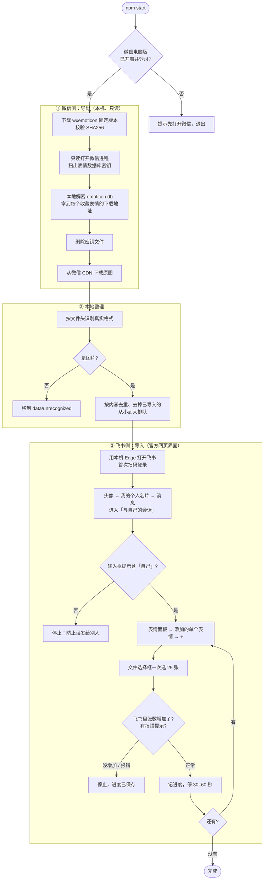

# wechat2feishu

把**微信电脑版里收藏的表情**一键批量导入到**飞书的「添加的单个表情」**。

- 微信侧只读：不改动微信、不以你的身份做任何操作，解密用的密钥用完即删
- 飞书侧只走官方网页界面：模拟你自己点「+」选图片，不调用任何内部接口
- 慢速分批（默认每批 25 张、批间停 30–60 秒），遇到报错或上限提示立即停
- 断点续传：中途关掉也没关系，重新运行会跳过已导入的

> 实测：微信 4.x（Windows）847 个收藏表情，下载 96 秒；导入飞书每 25 张约 1 分钟。

## 快速开始

需要：Windows 10/11、[Node.js 20+](https://nodejs.org/)、Edge 或 Chrome（系统自带 Edge 即可）、微信电脑版 4.x。

```bash
git clone https://github.com/Lazyy-star/wechat2feishu.git
cd wechat2feishu
npm install
```

1. **打开微信电脑版并登录**（导出期间保持开着）
2. 运行（建议先试 30 张）：

   ```bash
   npm start -- --limit 30
   ```

   不想用命令行的话，双击 `一键导入.bat`（等同于 `npm start`，会导入全部）。
3. 第一次会弹出浏览器窗口，**用飞书 App 扫码登录**。登录状态会保存在 `data/browser-profile`，以后不用再扫。
4. 等它跑完。没问题就去掉 `--limit` 再运行一次，导入剩下的。

运行过程中不要操作弹出的那个浏览器窗口。

## 常用参数

| 参数 | 说明 |
|---|---|
| `--limit N` | 本次最多导入 N 张 |
| `--batch N` | 每批张数，默认 25（最大 50） |
| `--pause A-B` | 批间随机停顿秒数，默认 `30-60` |
| `--wxid ID` | 电脑上登录过多个微信时指定账号（不传会列出可选项） |
| `--skip-export` | 不重新从微信导出，直接用上次下载的图片 |
| `--from DIR` | 不碰微信，直接把 DIR 里的图片导入飞书 |
| `--browser chrome` | 用 Chrome 代替 Edge |
| `--dry-run` | 只导出和整理，不打开飞书 |

例：`npm start -- --skip-export --batch 20 --pause 60-90`

## 它是怎么工作的



## 安全与风险（使用前请读）

- **微信**：导出依赖第三方工具 [wxemoticon](https://github.com/liusheng22/export-wechat-emoji)，它用 Windows 的只读权限（`PROCESS_VM_READ`）读取微信进程内存来找数据库密钥，不注入代码、不写内存。本工具只在检测到微信已经在运行时才调用它（避免它自己拉起再强制结束微信），并在拿到下载地址后立即删除密钥文件。
- **飞书**：只在「与自己的会话」里操作，进入前会核对输入框提示，核对不过就停；绝不点击表情格子（点了会直接发送）。
- **平台条款**：读取微信内存、自动化操作飞书网页，可能不符合两家平台的用户协议。作者无法保证不会触发风控，**风险由使用者自行承担**。建议保持默认的慢速节奏，不要把 `--batch` 调太大、`--pause` 调太小。
- **公司飞书**：如果飞书账号属于公司，请先确认公司 IT 规定是否允许。

## 已知限制

- 只支持 Windows + 微信 4.x 电脑版；飞书界面需为中文
- 只导出「收藏的表情」，不包括下载的整套表情包
- 少数表情下载下来是没解开的加密文件，会被放进 `data/unrecognized`，无法导入
- 飞书会自动去掉内容重复的表情，所以「新增」偶尔会比「选了」少一两张
- 飞书个人表情的总数上限、单张大小上限官方未公布；实测 267 张未触顶。遇到上限时工具会停下并提示
- 依赖飞书网页的页面结构，飞书改版后可能需要更新选择器（`src/feishu.js` 顶部的 `SEL`）

## 数据都放在哪

全部在仓库目录下的 `data/`（已加入 `.gitignore`，不会被提交）：

| 路径 | 内容 |
|---|---|
| `data/stickers/` | 从微信导出的表情原图 |
| `data/unrecognized/` | 无法识别的文件 |
| `data/state.json` | 导入进度（已导入图片的内容哈希） |
| `data/browser-profile/` | 飞书登录状态，**相当于登录凭证，不要发给别人** |

想彻底清除：删掉 `data/` 和 `vendor/` 两个文件夹即可。

## 常见问题

**下载 wxemoticon 失败？** 需要能访问 GitHub。可以设置代理：`set HTTPS_PROXY=http://127.0.0.1:端口`；或手动下载 [wxemoticon-x86_64-windows.zip](https://github.com/liusheng22/export-wechat-emoji/releases/download/v0.3.0/wxemoticon-x86_64-windows.zip) 放进 `vendor/`，工具会校验 SHA256 后使用。

**提示「没能自动打开与自己的会话」？** 在弹出的浏览器里手动点开和自己的聊天、清空输入框，工具会自动继续（等 3 分钟）。失败截图在 `data/debug-selfchat.png`。

**想换个飞书账号？** 删掉 `data/browser-profile/` 重新运行，扫新账号的码。

## 第三方组件

- [wxemoticon](https://github.com/liusheng22/export-wechat-emoji)（作者 liusheng22）：**不随本仓库分发**。运行时从作者的 GitHub Release 下载 v0.3.0，并校验 SHA256 `ceb10c0b…a033d0` 后使用。
- [Playwright](https://playwright.dev/)（Apache-2.0）：驱动本机浏览器。

## 开发

```bash
npm test                     # 单元测试（格式识别、队列、进度文件）
```

`scripts/dev-probe.mjs` 用来在飞书改版后排查页面结构：先用 `--remote-debugging-port=9333` 启动一个 Edge 并登录飞书，再 `node scripts/dev-probe.mjs 你的探测脚本.mjs`。

## License

MIT
